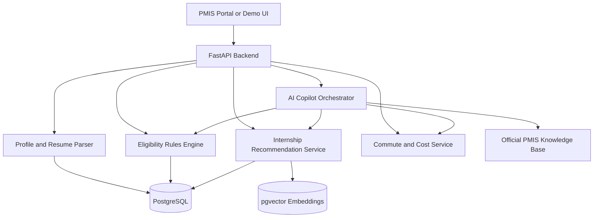

# PMIS Career Copilot

**An API-first, explainable AI career assistant for the Prime Minister Internship Scheme (PMIS).**

> **Project status:** Proposed / in development. This is an independent competition prototype, **not an official Government of India or Ministry of Corporate Affairs product**. Features listed below are planned unless explicitly marked complete.

**Official portal:** https://pminternship.mca.gov.in/

## Overview

PMIS Career Copilot is designed as a modular AI/ML system that can be integrated into the existing [PM Internship Scheme portal](https://pminternship.mca.gov.in/). Instead of replacing the portal, it adds intelligent internship discovery, resume understanding, eligibility guidance, actionable chat assistance, and practical commute information.

**Main goal:** Help candidates discover internships that fit their qualifications, interests, skills, and practical constraints—and understand *why* each opportunity is recommended.

## Core Feature Checklist

### 1. Resume Intelligence
- [ ] Upload resumes in PDF or DOCX format
- [ ] Extract education, skills, experience, and projects
- [ ] Generate a **heuristic resume-quality score** (not a universal or employer-verified ATS score)
- [ ] Identify missing or unclear resume sections
- [ ] Suggest improvements tailored to an internship description
- [ ] Allow users to review and correct extracted information

### 2. Eligibility & Internship Matching
- [ ] Maintain versioned eligibility rules from official PMIS documentation
- [ ] Check candidate eligibility **before** ranking opportunities
- [ ] Match resumes and profiles to internships using semantic search
- [ ] Combine skills, interests, qualification, location, and availability in ranking
- [ ] Explain match reasons and unmet requirements
- [ ] Filter opportunities by location, sector, qualification, and interests
- [ ] Compare shortlisted internships side by side
- [ ] Display uncertainty when listing details are incomplete

### 3. Action-Oriented AI Copilot
- [ ] Answer questions grounded in official PMIS documents, with source references
- [ ] Find and compare internships using natural-language queries
- [ ] Explain eligibility outcomes and application requirements
- [ ] Explain application statuses when authorized status data is available
- [ ] Guide candidates through forms and common errors
- [ ] Escalate unresolved questions to existing support channels (where integrated)
- [ ] Ask for confirmation before any action that changes user data
- [ ] Prevent unsupported claims about acceptance, eligibility, or availability

### 4. Commute & Affordability Advisor
- [ ] Let candidates enter a preferred area or approximate location
- [ ] Show internship location and estimated travel distance
- [ ] Estimate travel time for supported transport modes
- [ ] Estimate commute or relocation expenses with transparent assumptions
- [ ] Highlight opportunities that fit distance and budget preferences
- [ ] Avoid storing precise location unless necessary and consented to

## Optional / Advanced Feature Checklist

### 5. Multilingual Voice Assistance
- [ ] Accept voice questions
- [ ] Provide spoken responses
- [ ] Support English and Hindi initially
- [ ] Extend to selected regional languages
- [ ] Support voice-based internship search and guidance

### 6. Smart Document Assistant
- [ ] Upload educational documents with explicit consent
- [ ] Extract relevant fields using OCR/document AI
- [ ] Suggest application form values for user review
- [ ] Flag missing or inconsistent information
- [ ] Explore credential verification only through authorized integrations (e.g., approved issuers/DigiLocker access)
- [ ] Never present OCR extraction as proof of authenticity

### 7. Career Preparation
- [ ] Identify skills relevant to shortlisted internships
- [ ] Explain skill gaps without making automatic rejection decisions
- [ ] Recommend accessible, free learning resources
- [ ] Generate role-specific mock interview questions
- [ ] Provide practice feedback with appropriate limitations

### 8. Dashboard & Integration
- [ ] Add resume upload and editable candidate profile components
- [ ] Show recommended internships and explainable match indicators
- [ ] Add an embedded Copilot panel
- [ ] Show eligibility and document guidance
- [ ] Expose reusable APIs for portal integration
- [ ] Implement authentication, access control, consent, and audit logs
- [ ] Build a responsive, accessible interface for mobile and desktop

## Proposed Candidate Journey

1. **Create or import a profile** — Candidate enters preferences and optionally uploads a resume.
2. **Review extracted data** — Candidate corrects skills, education, and experience.
3. **Check eligibility** — A rule engine evaluates current scheme criteria.
4. **Discover internships** — Semantic retrieval finds relevant eligible listings.
5. **Understand recommendations** — The dashboard explains matches, gaps, and commute implications.
6. **Ask the Copilot** — Candidate compares options and receives source-grounded application guidance.
7. **Apply through official workflows** — The prototype does not submit applications without an authorized integration and explicit confirmation.

## Architecture (Proposed)

### Suggested Technology Stack

| Layer | Proposed technology |
| --- | --- |
| Demo frontend | React / Next.js, Tailwind CSS |
| API backend | Python, FastAPI |
| Database | PostgreSQL |
| Semantic retrieval | Sentence-transformer or API embeddings + pgvector |
| AI assistant | LLM with retrieval-augmented generation (RAG) |
| Resume/document parsing | PDF/DOCX parsers; OCR when necessary |
| Rules | Versioned deterministic eligibility rules |
| Voice (optional) | Speech-to-text and text-to-speech services |
| Maps (optional) | Authorized routing/geocoding provider |

> **Note:** No specific third-party AI model or external integration has been selected or connected yet.

## Draft API Modules

These endpoints are **proposals**, not implemented services.

| Method | Endpoint | Purpose |
| --- | --- | --- |
| `POST` | `/api/resume/parse` | Extract editable profile data from a resume |
| `POST` | `/api/resume/review` | Provide resume-quality feedback |
| `POST` | `/api/eligibility/check` | Evaluate eligibility against versioned rules |
| `POST` | `/api/internships/recommend` | Return ranked, explainable recommendations |
| `POST` | `/api/internships/compare` | Compare shortlisted opportunities |
| `POST` | `/api/copilot/chat` | Handle source-grounded questions and tool calls |
| `POST` | `/api/commute/estimate` | Estimate commute practicality and cost |
| `POST` | `/api/documents/extract` | Extract fields for confirmation (optional) |

## MVP Development Roadmap

### Phase 1 — Data & Rules
- [ ] Collect approved public scheme documents and record update dates
- [ ] Create a sample/synthetic internship dataset
- [ ] Define candidate and internship schemas
- [ ] Implement eligibility rules with test cases

### Phase 2 — Matching Engine
- [ ] Build resume parsing and editable profiles
- [ ] Generate internship embeddings
- [ ] Implement semantic retrieval and deterministic filters
- [ ] Add interpretable match explanations

### Phase 3 — Copilot & Commute
- [ ] Build RAG knowledge base from official sources
- [ ] Connect chatbot to eligibility and recommendation APIs
- [ ] Add commute estimates using clearly labeled assumptions
- [ ] Implement source citations and fallback responses

### Phase 4 — Integration & Evaluation
- [ ] Build a minimal responsive demo dashboard
- [ ] Test with synthetic candidate scenarios
- [ ] Evaluate eligibility accuracy and top-5 recommendation relevance
- [ ] Test Hindi/English accessibility where supported
- [ ] Review privacy, security, and consent flows
- [ ] Prepare demo and competition presentation

## Evaluation Metrics

- **Eligibility accuracy:** Agreement with verified official eligibility rules.
- **Precision@5:** Fraction of the top five suggestions judged relevant in a labeled test set.
- **Explanation usefulness:** Whether users understand the match reasons.
- **Task completion:** Time required to find suitable internships versus a baseline workflow.
- **Answer grounding:** Whether chatbot claims are supported by official source material.
- **Accessibility:** Keyboard, mobile, screen-reader, and language usability checks.

## Privacy, Fairness & Reliability

- Use synthetic or properly authorized data for development and demonstrations.
- Obtain informed consent for resume, document, and location processing.
- Minimize collection and retention of personally identifiable information.
- Keep eligibility decisions rule-based, auditable, and tied to current official sources.
- Do not use opaque AI scores to automatically reject applicants.
- Show estimated costs and resume scores as estimates, not verified facts.
- Require explicit user confirmation before any submission or profile modification.
- Integrate with government systems only after obtaining required authorization.

## Scope & Disclaimer

PMIS Career Copilot is a **proposed integration module**, not a replacement for the official PMIS portal. This README describes planned functionality; it does not imply that the AI features are already built, deployed, endorsed, or connected to government services. Official eligibility and application decisions remain with the authorized PMIS system.

